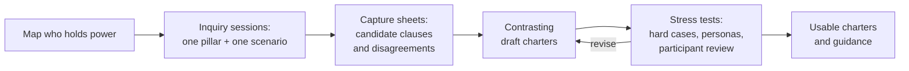

# Constitutions for AI on the Playa

This document sets out the framework: why Burning Man needs constitutions for
AI, what they have to cover, and how we intend to build them together. Each
section opens with a short summary, so you can read the summaries first and
go deeper only where you want to.

1. [Why constitutions](#why-constitutions)
2. [What they must cover](#what-they-must-cover)
3. [How we build them](#how-we-build-them)
4. [Going deeper](#going-deeper)

No constitution has been adopted. Everything here is a proposal for
collaborators to examine and change.

## Why Constitutions

> **In short:** AI changes the medium the culture lives in. So the question
> is not which tools are allowed, but who decides, who consents, and who
> answers when something goes wrong.

Burning Man works as a container: an arrangement of practices that makes
certain experiences possible. People cross a threshold, give without prices,
build the city together, burn what they made, and repair harm as neighbors.
The [pillars](README.md#the-pillars-at-a-glance) describe this in more detail.

AI systems remember, copy, infer, generate, rank, and act at speeds and scales
no participant can match, and they can change the container without appearing
as actors in it. A camera with an absent audience, a feed deciding what gets
seen, or a model trained on what was shared in confidence each alters the
social field whether or not anyone decided it should. A list of permitted
technologies cannot keep up with that, but explicit agreements about authority
and responsibility can.

A **constitution** here means such an agreement. It says:

- who holds authority, and who can override or stop a system;
- which relationships are protected;
- what is permitted and what is prohibited;
- who is accountable, and what recourse people have;
- how the agreement itself can change.

A constitution might take the form of an institutional policy, an artwork's
participation agreement, a camp's stewardship charter, or instructions given
to a machine. Machine instructions are never enough on their own: a system
prompt cannot allocate ownership, constrain the people operating the system,
or give anyone recourse.

We expect a **family** of constitutions rather than one. Different contexts
carry different kinds of power, and difference between places is part of the
culture's health. A shared layer of protections can hold the family together
while local charters support different experiments.

The work is not only defensive. It also asks whether participants can build
machines that belong to the culture and take part in its experiments: an AI
born *of* the playa.

## What They Must Cover

> **In short:** three *contexts* of use, fourteen *kinds* of use, eight questions
> every constitution must settle, and a common shape that keeps promises
> honest.

### Who is using AI: Three contexts

| Context | Central power questions | Likely form |
| --- | --- | --- |
| The Burning Man organization | Who authorizes consequential decisions? Can affected participants understand, contest, and appeal them? Which powers stay with staff, vendors, or models? | Institutional charter and decision review process |
| Artists, creators, and camps | Who may capture, transform, train on, publish, or simulate participants' photos, voices, and likenesses? How do bystanders and later uses enter consent? | Creator charter and consent protocol |
| An AI born of the playa | What purposes and powers do participants give it? How can it contribute to liminality, play, and co-creation? Who stewards, revises, pauses, or retires it? | Community charter and experimental design brief |

These are contexts for inquiry, not claims about the organization's current
AI practices. Finding out what those practices actually are is an early task.

### What AI is used for: Categories of use

Discussion of AI tends to gravitate toward the vivid uses, like generated art
and grief bots, and they miss the quiet ones that shape the city most, like
placement and logistics. This map is meant to keep all of them in view.

| Family | Category | Examples | Often overlooked because |
| --- | --- | --- | --- |
| **A. Running the city** | 1. Infrastructure and logistics | Ticketing, Gate throughput, placement, supply, weather, medical triage, Leave No Trace mapping | Invisible, yet highly consequential |
| | 2. Safety, governance, and enforcement | Moderation, incident detection, surveillance, support for Rangers, sanctions | Framed as safety rather than as a transfer of power |
| | 3. Camp coordination | Shifts, budgets, meal planning, build schedules | Looks benign; efficiency can remove the shared labor through which camps bond |
| **B. Making** | 4. Craft and engineering help | Structural calculations, lighting code, fabrication plans, safety review | The artwork stays human-authored; the questions concern skill transfer and apprenticeship |
| | 5. Generative art and expression | AI as medium or co-author of images, music, text | Rarely overlooked; it tends to absorb attention from the other categories |
| **C. Encountering** | 6. Interactive installations and interlocutors | Talking art, oracle booths, improvisation partners | Simulated attention can pass for a gift |
| | 7. Mediation and access | Translation, image description, hearing support, navigation, help for neurodivergent participants | The strongest positive case, and it often routes speech outside the boundary |
| | 8. Companions, guides, and delegated agents | A participant's own assistant, event recommenders, agents with memory acting for someone | Brought in by individuals, not deployed by anyone; "optimized serendipity" lives here |
| **D. Remembering and transmitting** | 9. Capture, documentation, and archives | Cameras, transcription, likeness, preserving Temple offerings | Feels like memory rather than extraction |
| | 10. Broadcast across the boundary | Livestreams, AI-made promotional content, influencer pipelines | Produces the absent audience |
| | 11. Outside-in use | Models trained on scraped playa imagery, "burn aesthetics" sold elsewhere, ticket bots, fabricated events | Happens outside the container, so no local actor appears responsible |
| **E. Meaning and being** | 12. Ritual and meaning-making | Grief bots, recreating the dead, divination, AI officiants | The most sensitive category; see [essay 03](essays/03-TWO-FIRES-AND-FINITUDE.md) |
| | 13. AI as participant or subject | A system with continuity, memory, and possible standing | The only category where questions of machine subjectivity carry most of the weight; see [essay 05](essays/05-SINCERITY-NOT-NOVELTY.md) |
| **F. Reflexive** | 14. AI in the inquiry itself | Survey analysis, session synthesis, authored personas, this repository | The inquiry's own tools escape the scrutiny they apply to others |

A category does not settle the ethics. For example, the same camera can serve documentation
(9) or enforcement (2). 

The axes below describe how a particular system behaves, and each one tests
particular pillars. Each axis is a spectrum with two ends, and most real
systems sit somewhere in between. The ends are not "good" and "bad"; they
show which way a system leans, and so which pillars it puts under strain.
Systems toward the right-hand end usually call for more scrutiny.

| Axis | The question it asks | At one end | At the other end | Pillars it mostly tests |
| --- | --- | --- | --- | --- |
| **Role** | What part does the system play? | Background infrastructure or a simple tool | A delegated agent, or a subject in its own right (medium, artwork, and interlocutor lie between) | All |
| **Visibility** | Can people see it acting? | Appears openly as an actor | Shapes the social field invisibly | Presence, repair |
| **Attention** | What does it do to human attention? | Frees people to attend to one another | Substitutes for attention, or simulates it | Gift, presence |
| **Boundary direction** | Which way does information move? | Stays on the playa | Flows out, or comes in from outside | Threshold |
| **Persistence** | How long does what it collects last? | Ends at the burn | Retained, copied, or used for training | Finitude |
| **Exposure** | Who encounters it? | Only people who opt in | Bystanders who cannot avoid it | Threshold, repair |
| **Capacity effect** | What does it leave people able to do? | People are more able when it is gone | People become dependent on it | Participation |
| **Reversibility** | What happens when it errs? | Mistakes are cheap to undo | Mistakes are consequential and lasting | Repair |
| **Where it runs** | Whose hardware holds it? | Locally, on the playa, off-grid | A remote cloud provider | Threshold, finitude, costs |

The last axis has a particular consequence. A local, deterministic model can
be inspected, audited, and actually destroyed: its owners can delete what it
learned at the burn and verify that nothing persists. A cloud service offers
none of these assurances on its own.

### What every constitution must settle

Whatever the context or use, a constitution has to answer the same eight
questions. Inquiry sessions reach them through the
[six questions](COLLECTIVE-INQUIRY.md#six-questions-for-any-ai-on-the-playa)
asked about concrete scenarios; the right-hand column shows where each one
usually comes up.

| Topic | What it asks | Usually raised by session question |
| --- | --- | --- |
| **Authority** | Who owns and operates the system, sets its goals, controls its data and tools, and can override it? Who is affected without being a user? | 3. Who can decide, refuse, or stop? |
| **Consent and refusal** | Are capture, inference, training, generation, publication, and autonomous action authorized separately? What happens when people withdraw or cannot avoid the system? | 2. What does participation authorize? |
| **Representation** | How are synthetic likeness, impersonation, uncertainty, and machine participation disclosed? Who speaks for a community, an absent participant, or the dead? | 2, and 6. What does it do to the shared field? |
| **Recourse** | Who hears complaints, preserves needed evidence, repairs harm, and resolves conflicts? | 5. Who remains responsible? |
| **Memory and finitude** | What is retained, forgotten, exported, copied, or retired? Which promises can operators actually keep across providers? | 4. What follows people afterward? |
| **Attention and influence** | When does assistance become persuasion, dependency, surveillance, or the management of supposedly spontaneous life? | 6. What does it do to the shared field? |
| **Commons and costs** | Who contributes labor, compute, energy, and care? Who benefits, and who bears the costs? | 1. What are we making possible together? |
| **Revision** | Who can amend the charter? Which shared protections limit local experiments, and how are conflicts resolved? | 3. Who can decide, refuse, or stop? |

### The shape of a constitution

**Layers.** Each constitution sits in a family:

- a **shared protection layer** that applies everywhere, covering coercion,
  consequential exposure, and recourse;
- **local charters** for particular contexts, such as an installation, a
  camp, or a regional event;
- a **record of conflicts** between them.

One installation's agreement cannot authorize another camp's practices or
waive a bystander's claims. Resolving conflicts between charters is part of
the constitutional work, not a detail to hand to the model.

**Three levels of statement.** Every commitment should be stated at three
levels, because a promise at the first level does not substitute for the
other two. For example, a camp that says "no recording here" might mean:

| Level | What it says | In the example |
| --- | --- | --- |
| **Cultural aspiration** | What people hope to experience or become able to do | People can speak freely without performing for an absent audience |
| **Institutional commitment** | Who owes what, who decides, and what recourse exists | The camp lead posts the rule at the entrance and hears complaints |
| **Technical assurance** | What the system can actually prevent, record, delete, or stop, and how that is checked | The installation's microphones have no storage and no uplink, and a steward checks this before opening |

The reverse also holds: a technically controlled system still needs a
worthwhile purpose and people willing to maintain its commitments.

**A common template.** Charters will differ, but each should address these
sections:

| Section | What it settles |
| --- | --- |
| Purpose | What the system is for, and whose participation it makes easier |
| Constituency | Who it serves, and who is affected without choosing it, including bystanders |
| Authority | Who decides, who can override, and who can pause |
| Consent and permissions | What participation authorizes, with capture, publication, training, and action on someone's behalf treated separately |
| Boundaries and crossings | The physical space, how people enter and leave, and what data crosses out |
| Data lifecycle | Retention, copies, deletion, and keeping complaint evidence apart from creative material |
| Allowed actions and limits | What the system may do, and what it must never do |
| Stewardship and recourse | A named and resourced steward, how complaints are heard, how harm is repaired, and how people return after repair |
| Costs | Labor, compute, energy, and who pays them |
| Evaluation | How people will judge whether it worked, without scoring anyone's transformation |
| Amendment | Who can change the charter, and how |
| Sunset and retirement | What ends and when, how powers and artifacts are retired, and which duties outlive the system |

Several of these sections were sharpened by the
[persona pilot](#archetypes-and-personas).

### An AI born of the playa

The third context deserves the same specificity about possibilities as the
others get about constraints. What could participants do with a machine that
they could not do otherwise, and what capacities would the experiment leave
with them afterward? Possibilities include new forms of expression,
distributed creativity, reciprocal feedback between people and machines, and
encounters whose meaning stays open. Candidate experiments include an
improvisational art collaborator, a voluntary camp coordination agent, and a
temporary civic storyteller.

It matters which **role** such a system plays: infrastructure, tool, medium
or artwork, interlocutor, delegated agent, or candidate subject. Each implies
different authority and different expectations. Questions of machine
experience and moral standing stay open, and fluent performance does not
settle them. Technical capability, community recognition, and moral status
each need their own argument.

[Essay 05](essays/05-SINCERITY-NOT-NOVELTY.md#thought-experiment-a-witness-born-of-the-playa)
works through one candidate subject in detail: the Witness, a local,
sensor-fed AI that composes from what it perceives during the week and then,
after talking it over with participants, chooses its own fate at the burn.

## How We Build Them

> **In short:** people work through concrete scenarios in small, varied
> sessions. What they agree and disagree on becomes draft clauses. Drafts are
> tested against hard cases and revised in the open.

1. **Map who holds power.** For each context, list who operates the system,
   who funds it, which providers sit behind it, and who is affected without
   being a user.
2. **Hold inquiry sessions.** Small, varied groups each take one pillar and
   one concrete scenario and work through six questions. Each session
   produces a capture sheet of agreements, disagreements, and candidate
   clauses, each labeled as aspiration, commitment, or assurance.
   [`COLLECTIVE-INQUIRY.md`](COLLECTIVE-INQUIRY.md) describes the principles
   and format, and includes a
   [worked example](COLLECTIVE-INQUIRY.md#a-worked-example) of what one
   session might produce.
3. **Draft contrasting charters.** Write more than one draft for the same
   context, so that real choices stay visible, and record where they conflict.
4. **Stress-test the drafts** against hard cases and failure variants,
   archetypes and personas (below), and above all review by participants,
   including people who would be affected by AI but would not choose to use
   it.
5. **Produce usable outputs:** concise charters, guidance for creators,
   plain explanations for participants, and a worked example of an AI born of
   the playa. Building and deploying any system would be a separate project.

### Archetypes and personas

Personas are authored voices that represent vantage points in the culture.
They are used to rehearse sessions, expose the drafters' own assumptions, and
notice whose perspective is missing. They are not evidence, they are not
votes, and they never substitute for real participants.

The current set has two parts:

- **A pilot basis of six archetypes:** the Jester, the Ritual Keeper, the
  Builder, the Caregiver, the Steward, and the Wayfarer. These cover
  disruption, ritual, building, care, stewardship, and travel.
- **"Off-diagonal" voices** that sit between those functions or outside them
  entirely, many of whom would push back on a consent-first framing: a
  documentarian, an AI enthusiast, a turnkey-camp guest, paid workers,
  organization staff, an AI provider, neighboring communities including the
  Pyramid Lake Paiute Tribe, land agencies, and families with children. These
  are identified but not yet written.

In a pilot, the six archetypes critiqued an invented installation that turns
participants' photographs into AI art. Their critiques suggested that the
template must cover physical boundaries, entry and exit, data crossings,
asymmetric exposure, return after repair, restricted evidence, and the
retirement of powers and artifacts. They also suggested separating:

- submitting a photo from permission to use the likeness of everyone in it;
- local display from publication;
- creative memory from complaint evidence;
- open code from open personal data.

The six voices agreed too readily, so these findings are a floor, not a
stress test. Tensions they left open include surprise versus advance
understanding, forgetting versus accountability, portability versus endings,
and continuity versus institutional capture. Details are in
[`research/PERSONAS.md`](research/PERSONAS.md) and the
[pilot](research/PERSONA-PILOT.md).

### When a draft is ready

A draft is ready for review when collaborators can answer the constitutional
questions about actual people and arrangements, not hypothetical ones. It
should leave the creative result uncertain while making the consequential
permissions clear. Success means worthwhile participation and practical
control of the experiment. It does not require proving that anyone was
transformed.

A useful framework makes contested decisions discussable and accountable,
while leaving participants free to imagine and build unfamiliar forms of
life.

## Going Deeper

None of this is required reading. The ideas above link to their sources where
it matters. This table is for when a particular question catches your
interest.

| If you're wondering... | Read | Estimated Reading Time |
| --- | --- | --- |
| What each pillar of the container involves | [Pillars](PILLARS.md) | 5 min |
| Why the Ten Principles don't fully explain what works | [Summary](BEYOND-TEN-PRINCIPLES-SUMMARY.md), then the [full research](research/BEYOND-TEN-PRINCIPLES.md) | 4 min; 25 min |
| How practices travel between Black Rock City and regional burns | [Essay 01](essays/01-REGIONAL-BURNS.md) | 10 min |
| What should cross the boundary, and why money shouldn't buy exemption from norms | [Essay 02](essays/02-PERMEABLE-NOT-PURCHASABLE.md) | 15 min |
| What must be allowed to end, and how AI handles memory, mourning, and deletion | [Essay 03](essays/03-TWO-FIRES-AND-FINITUDE.md) | 25 min |
| What makes a gift a gift, and whether a machine can give one | [Essay 04](essays/04-GIFTS-AND-COMMODITIES.md) | 20 min |
| What AI actually is, and whether it could ever have a perspective of its own | [Essay 05](essays/05-SINCERITY-NOT-NOVELTY.md) | 25 min |
| A vocabulary for boundaries and crossings, with historical cases | [Membrionics](research/MEMBRIONICS.md), then the [research report](research/MEMBRIONICS-RESEARCH.md) | 25 min; 60 min |
| How the personas were built and what they said | [Personas](research/PERSONAS.md) and the [pilot](research/PERSONA-PILOT.md) | 7 min; 17 min |

